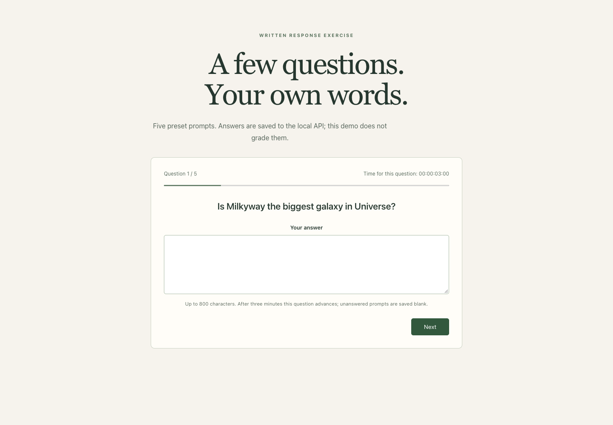

# Written-response collection exercise

A small React and Django REST Framework application that presents five preset prompts and stores the written answers in SQLite. Despite the repository name, it does not implement grading, an AI evaluator, a validated assessment, or goal scoring. The browser submits a placeholder score of zero and empty submitter/evaluator labels.



The [mobile preview](docs/quiz-mobile.png) uses the same bundled question. Browser verification entered synthetic answers and intercepted the API response; no real submission or personal information was used.

## Two separate packages

`quiz-app-web/` is a Create React App client. `quiz_app_api/` is a Django API with questions, submitted answers, and quiz records. The server accepts plain JSON or the browser's `{ "data": ... }` wrapper and saves the complete submission in one database transaction.

## Run locally

Use Python 3.11, Node.js 22, and npm 11.6.2 for the reviewed frontend lock. In the backend directory:

```sh
cd quiz_app_api
python3 -m venv .venv
source .venv/bin/activate
pip install -r requirements.txt
export DJANGO_DEBUG=true
python manage.py migrate
python manage.py runserver 127.0.0.1:8000
```

The historical requirements pin Django 4.1.7; review tests used Django 4.2. The API reads process environment variables, not `.env` automatically. Explicit local debug generates an ephemeral key when none is supplied; a private `DJANGO_SECRET_KEY` is required otherwise. Hosts default to loopback names and browser CORS origins are limited to the local React development origins.

In another terminal:

```sh
cd quiz-app-web
npm exec --yes --package=npm@11.6.2 -- npm ci --ignore-scripts
cp .env.example .env
npm start
```

Open `http://localhost:3000`. `REACT_APP_API_BASEURL` is the backend origin, for example `http://localhost:8000/`. The client appends `/submit_quiz/`; the Django API does not use an `/api` prefix. No global database, seed script, or provider account is required.

## Timing and failed saves

The current explicit baseline is three minutes per question, matching the original auto-advance intent. Typing no longer restarts that deadline. Advancing stores the current answer, including a blank one if unanswered. The previous mixed total countdown was replaced with a per-question display. Whether the intended policy should instead be fifteen minutes overall or advisory-only is still an owner decision.

The final request disables duplicate submission while pending. A failed save keeps the final answer and the earlier answers for a manual retry, rather than clearing the draft before the server responds. Completion states that answers were saved and no grade was calculated. Reloading discards an unfinished browser draft; no persistent client draft or server idempotency key is implemented.

## API boundaries

`POST /submit_quiz/` accepts this shape, optionally wrapped in `data`:

```json
{
  "submittedBy": "synthetic-candidate",
  "evaluatedBy": "synthetic-evaluator",
  "score": 0,
  "question": [{"questionText":"A synthetic prompt?","answerText":"A synthetic response."}]
}
```

A successful response is 201 with `msg`. Payloads must be objects; questions must be a nonempty array of at most 100 objects. Question text is limited to 500 characters, answers to 800, and submitter/evaluator strings to 150. Score is only a supplied signed 32-bit integer, not a verified grade; there is no answer key or scoring rubric. Malformed values return 400 before records are written.

## Evidence and next work

Six Django API tests pass against a temporary SQLite test database, and six React/API tests pass. They cover both payload shapes, malformed input, all-or-nothing validation, the five-answer flow, failed-save retention, pending-submit disabling, and typing without extending the deadline. The CRA production build passes. Chrome verifies a synthetic failed final save, preserved retry payload, successful completion, and desktop/390px layout without page errors.

The original frontend lock selected an incompatible TypeScript 6 peer for CRA. TypeScript 4.9.5 is now explicit and npm 11 clean installation passed; npm 10 still rejected different peer-lock metadata. The framework was not migrated. Existing legacy dependency advisories and test-tool deprecation warnings remain separate maintenance work.

Useful next decisions are the timing rule, an actual evaluation rubric if scoring is wanted, and authenticated ownership if this will collect real responses. The current endpoint is anonymous, accepts caller-provided identity labels/score, has no submission idempotency, and is a local exercise. The preset trivia prompts have not been validated as an assessment or fact-checked in this review. There is no claimed AI/ML component.
