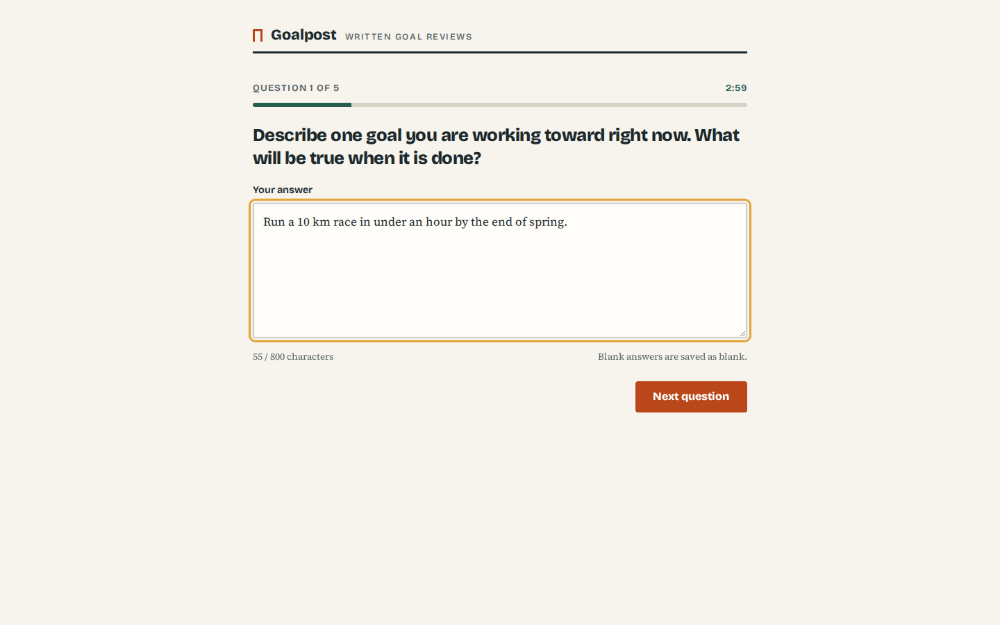
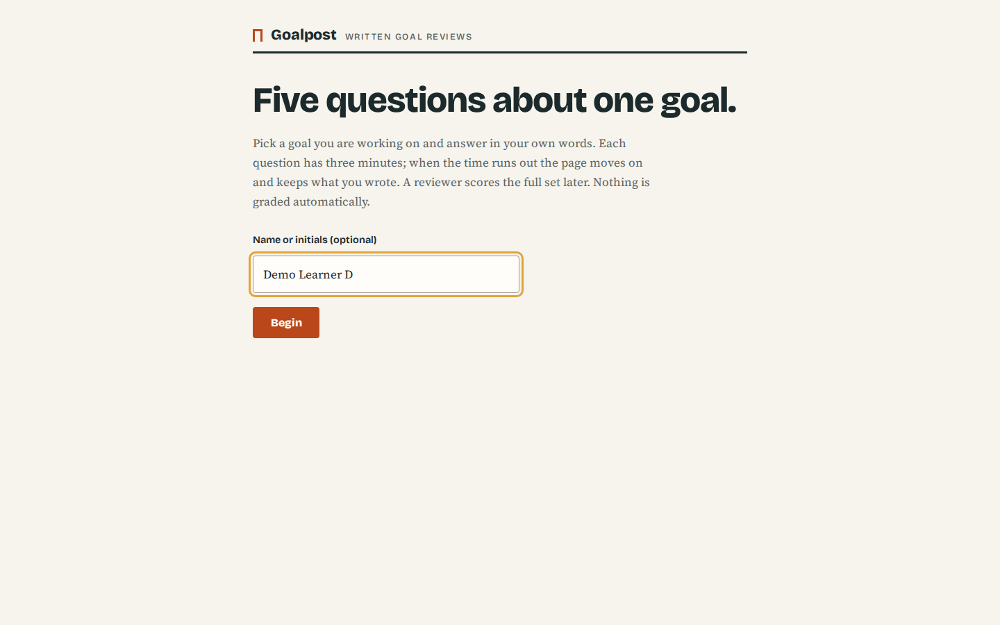
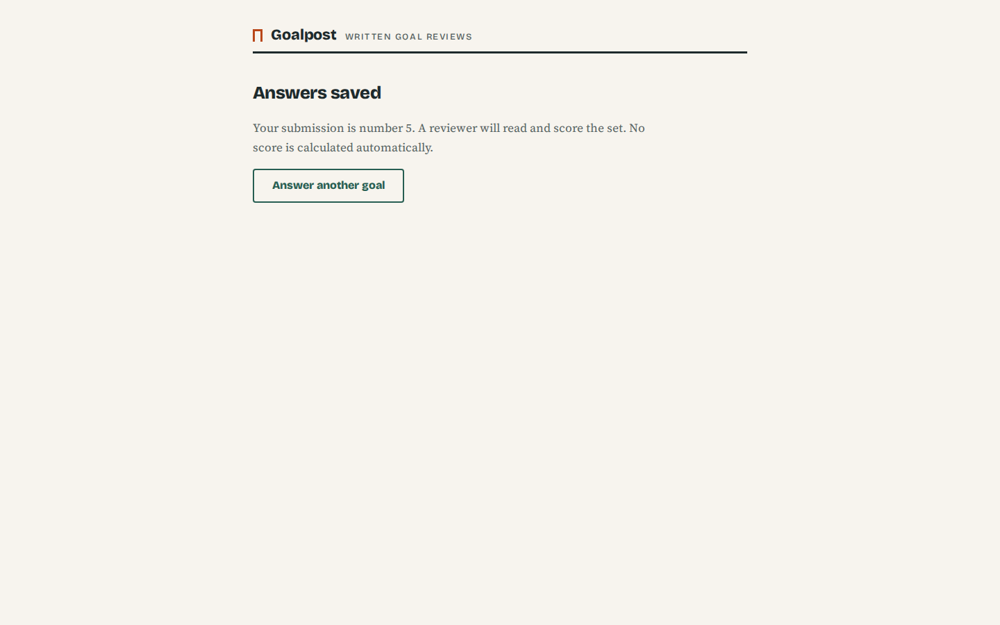
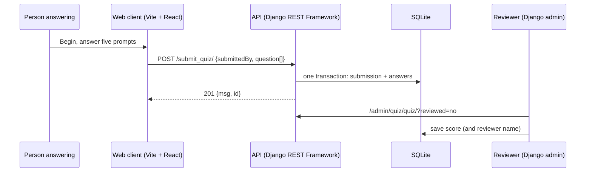
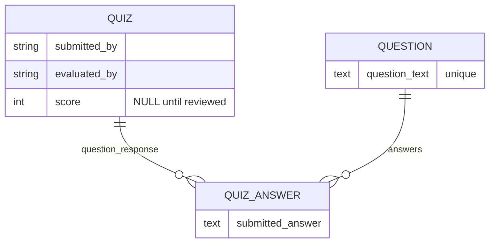
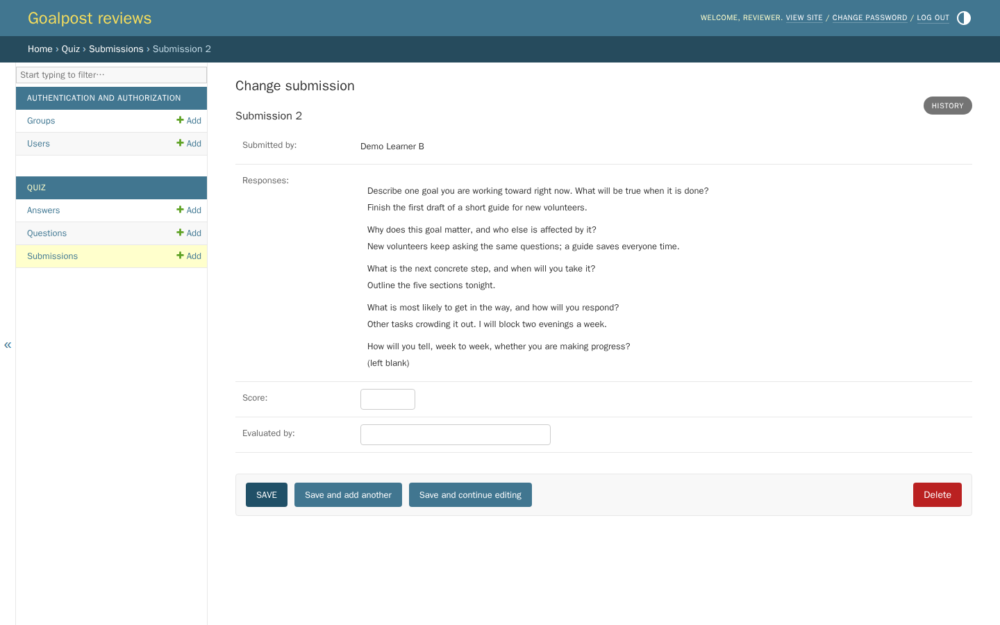
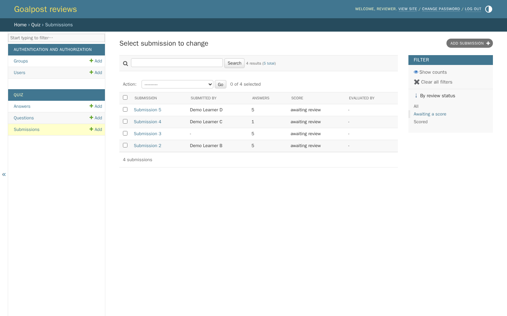
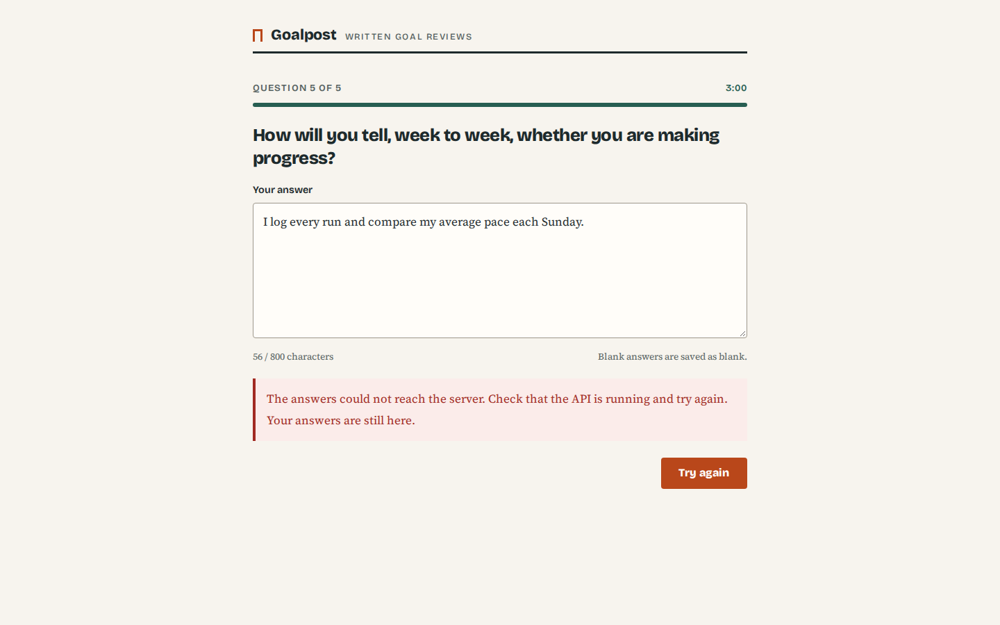
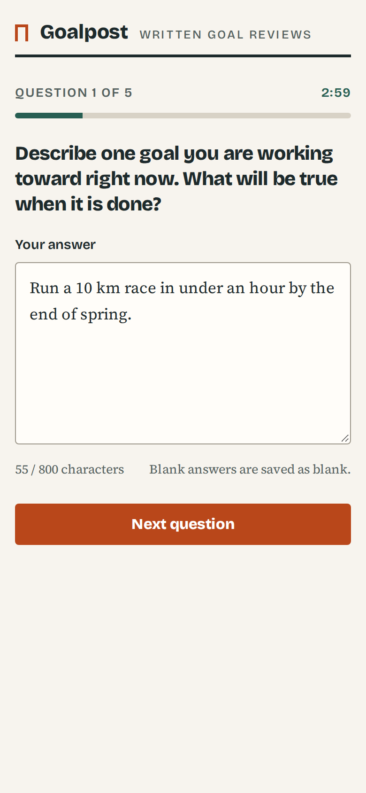

# Goalpost

Goalpost collects written answers to five questions about one goal and leaves the scoring to a person. Someone picks a goal they are working on, answers each question in their own words against a three-minute clock, and submits the set. A reviewer then reads the submission in the Django admin and records a score.

Nothing is graded automatically. There is no answer key, rubric engine or AI model; the score is whatever the reviewer enters, and a submission stays "awaiting review" until then.



| Start | Saved |
| --- | --- |
|  |  |

The project has two parts, and the folder names are historical:

- `quiz-app-web/`: the React 19 client, built with Vite.
- `quiz_app_api/`: the Django 5.2 REST API with SQLite. It also provides the reviewer screens through the Django admin.

## How it fits together





## Run it with Docker Compose

You need Docker with Compose v2.

```sh
cp .env.example .env
# edit .env and set DJANGO_SECRET_KEY to a long random string
docker compose up --build -d
docker compose exec api python manage.py seed_demo
docker compose exec api python manage.py createsuperuser
```

- Answer the questions at http://localhost:8080.
- Review and score at http://localhost:8000/admin/ with the account you just created.

`seed_demo` adds three fictional submissions, one scored and two awaiting review, but only when the database is empty. Data lives in the `api-data` volume; `docker compose down -v` removes it.

## Run without Docker

You need Python 3.13 and Node.js 22.12 or newer (`.python-version` and `.nvmrc` pin them).

API, in one terminal:

```sh
cd quiz_app_api
python3.13 -m venv .venv
source .venv/bin/activate
pip install -r requirements-dev.txt
export DJANGO_DEBUG=true
python manage.py migrate
python manage.py seed_demo
python manage.py createsuperuser
python manage.py runserver 127.0.0.1:8000
```

The API reads settings from process environment variables and does not load `.env` files itself; `quiz_app_api/.env.example` lists them. With `DJANGO_DEBUG=true` and no `DJANGO_SECRET_KEY`, it generates a throwaway key for that process. Without debug, a key is required.

Client, in another terminal:

```sh
cd quiz-app-web
npm ci
cp .env.example .env
npm run dev
```

Open http://localhost:5173. `VITE_API_BASEURL` in `quiz-app-web/.env` points at the API, and the client appends `/submit_quiz/`.

## Tests and lint

```sh
# API: 18 tests, ruff lint and format check
cd quiz_app_api
DJANGO_DEBUG=true python manage.py test --settings=quiz_app_api.test_settings
ruff check . && ruff format --check .

# Client: 19 tests, ESLint, production build
cd quiz-app-web
npm test
npm run lint
npm run build
```

The API tests cover both payload shapes, optional and nullable fields, every validation rule, all-or-nothing saving, the reviewer admin and the seed command. The client tests cover the intro screen, the five-answer flow, the timer (display, typing not extending it, and auto-submit when the last question runs out), focus handling, the character counter, keeping answers after a failed save, blocking duplicate submits, and the API client's error messages.

## API

There is one public endpoint. These examples were captured from the Compose stack.

`POST /submit_quiz/` takes a list of question/answer pairs. `submittedBy`, `evaluatedBy` and `score` are optional. The body may also be wrapped as `{"data": {...}}`, which is what the web client sends.

```sh
curl -s -X POST http://localhost:8000/submit_quiz/ \
  -H 'Content-Type: application/json' \
  -d '{"submittedBy": "Demo Learner C",
       "question": [{"questionText": "What is the next concrete step, and when will you take it?",
                     "answerText": "Draft the outline on Monday evening."}]}'
```

```
HTTP/1.1 201 Created
{"msg":"Quiz response saved successfully","id":4}
```

Malformed input is rejected with 400 before anything is written:

```
{"question": []}                         -> {"msg":"Question list must be a non-empty array"}
{"score": "7", "question": [...]}        -> {"msg":"Score must be a signed 32-bit integer or null"}
{"submittedBy": "Demo"}                  -> {"msg":"Missing required fields"}
```

The limits are 1 to 100 questions, 500 characters per question, 800 per answer and 150 for the name labels. Score, when sent, must be a signed 32-bit integer.

## Reviewing and scoring



The admin's submission list shows the number of answers and the review status, with a filter for submissions that are still unscored. A submission page shows each prompt with the answer underneath, and blank answers are marked as blank. If a reviewer saves a score and leaves "evaluated by" empty, their username is filled in.



## Design notes

- **Unscored is not zero.** `score` is `NULL` until someone scores the submission. The original client posted `score: 0` for every submission, so each one looked like a failed attempt; migration `0002` clears those placeholder zeros.
- **All or nothing.** The whole payload is validated before any row is written, and the inserts run in one transaction.
- **Prompts are stored by text.** `Question` rows are deduplicated by their text, so repeated submissions of the same prompt share one row.
- **Answers survive a failed save.** If the final request fails, the client keeps all five answers, shows the error and offers a retry, and the button is disabled while a request is pending.

  
- **Timing.** Each question has three minutes, starting when "Begin" is pressed. Typing does not extend the deadline. When time runs out the client moves on and keeps what was typed, and on the last question it submits.

On a phone the buttons go full width and the clock stays beside the question count:



## Configuration

| Variable | Where | Default | Purpose |
| --- | --- | --- | --- |
| `DJANGO_SECRET_KEY` | API, root `.env` for Compose | none | Required unless `DJANGO_DEBUG=true` |
| `DJANGO_DEBUG` | API | `false` | Local debug mode |
| `DJANGO_ALLOWED_HOSTS` | API | `localhost,127.0.0.1` | Comma-separated host names |
| `DJANGO_CORS_ALLOWED_ORIGINS` | API | `http://localhost:5173,http://127.0.0.1:5173` | Browser origins allowed to post answers |
| `DJANGO_CSRF_TRUSTED_ORIGINS` | API | `http://localhost:8000,http://127.0.0.1:8000` | Origins trusted for admin form posts |
| `DJANGO_SQLITE_PATH` | API | `quiz_app_api/db.sqlite3` | Database file; `/data/db.sqlite3` in Docker |
| `VITE_API_BASEURL` | client, build time | none | API origin, for example `http://localhost:8000/` |

## Limitations

- The submit endpoint is anonymous and has no rate limiting or idempotency key, so a person can submit the same set twice or post someone else's name. Add authentication before collecting real responses.
- The score is a free integer; there is no rubric or fixed range.
- Reloading the page discards an unfinished set, because drafts are not stored in the browser.
- The five prompts are kept in the client (`src/constants/constants.js`). The seed command has its own copy for its demo data.
- The admin is the only reviewer interface, and it needs a Django staff account.

## License

MIT; see [LICENSE](LICENSE).
